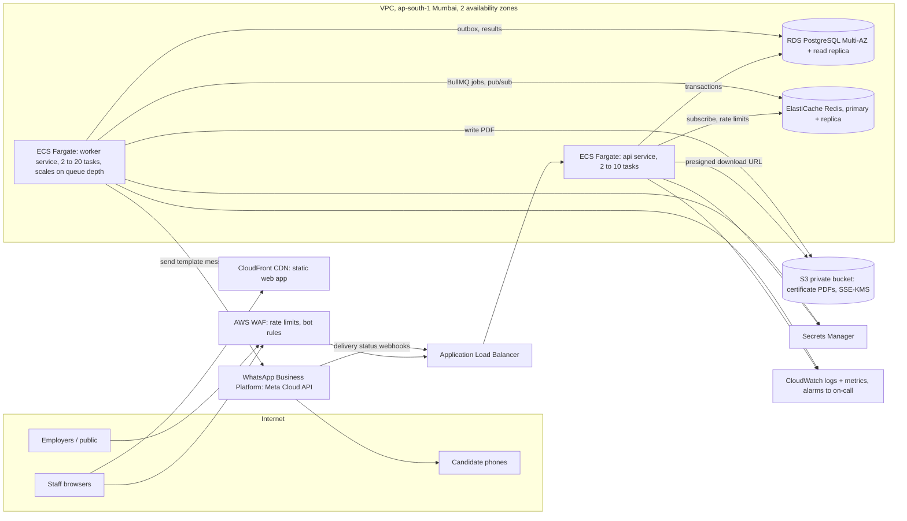

# Deployment plan

Production plan for CertiFlow at this load:
- 100,000 registered users, ~10,000 daily active
- **Results day peak:** ~500 batches approved in one hour → **~30,000 PDFs and ~30,000 WhatsApp messages**
- Public verification: thousands of lookups a day, in bursts (employers checking after a results announcement)

Nothing here needs a new kind of component compared to the local setup. Each container maps to a managed equivalent, so what we test locally is what runs.

---

## 1. Architecture



### Event flow
```
API transaction ──► OutboxEvent (Postgres) ──relay──► BullMQ: issuance ──► certificates (one tx) ──► OutboxEvent ×N
                                                └──► Redis pub/sub ──► every API task ──► SSE to browsers
OutboxEvent certificate.issued ──relay──► BullMQ: delivery ──► PDF to S3 ──► WhatsApp ──► status SENT / FAILED
Scheduler (BullMQ job scheduler, every 30 s) ──► SLA check ──► batch.escalated
```

---

## 2. Where each component runs, and why

| Component | Hosted on | Why |
|---|---|---|
| Web app (static) | S3 + CloudFront | Static files; global cache; nothing to run |
| API | ECS Fargate, 2+ tasks across 2 AZs, behind ALB | Stateless containers, same image as local; no servers or Kubernetes to operate for a small team |
| Workers | ECS Fargate, separate service | Scales on queue depth independently of the API; a stuck PDF can't slow down officers' clicks |
| Database | RDS PostgreSQL 16, Multi-AZ, 1 read replica | Source of truth; automatic failover, point-in-time recovery, backups. Replica serves public verification and reports |
| Redis | ElastiCache (primary + replica, Multi-AZ) | BullMQ + pub/sub + rate limits; managed failover |
| Certificate files | S3 private bucket, SSE-KMS, versioning | Durable, cheap, access only via short-lived presigned URLs |
| Secrets | AWS Secrets Manager | JWT and HMAC signing keys, DB credentials, WhatsApp token; rotated, never in images |
| WhatsApp | Meta WhatsApp Cloud API via approved **utility template** | Swap-in for the mock behind the same adapter (`src/lib/whatsapp.ts`) |
| Region | **ap-south-1 (Mumbai)** | Users and candidates are in India; MeitY-empanelled region, keeps citizens' data in the country |

**Why not Kubernetes:** two services and two managed data stores don't need it. Fargate gives autoscaling and rolling deploys with far less to operate. **Why not SQS instead of BullMQ:** a reasonable swap later (fully managed, very durable). We keep BullMQ so production behaves like the tested local system, and the Postgres outbox already makes event delivery durable even if Redis loses data.

**Sign-in in production** replaces the demo persona switcher: staff log in with the state's SSO (or mobile OTP). The session cookie becomes `Secure`, and the same role/district checks apply.

---

## 3. Scaling

### Peak maths (results day)
| Work | Volume per hour | Per second | Capacity per unit | Needed |
|---|---|---|---|---|
| Certificate issuance (DB inserts) | 30,000 rows in ~500 transactions | 8.3 | Postgres handles thousands of small writes/s | 1 DB, no issue |
| DB writes overall (certificate + audit + outbox + status updates ≈ 8 per certificate) | ~240,000 | ~70 | db.r6g.large: several thousand/s | Comfortable |
| PDF generation (pdfkit, ~50–100 ms CPU) | 30,000 | 8.3 | ~10–20/s per vCPU | 2–4 worker vCPUs |
| WhatsApp sends | 30,000 | 8.3 average | Meta throughput ~80 msg/s by default (higher tiers available) | Not a bottleneck: backlog drains in ~7 min |
| Public verification | bursts of maybe 50–100/s | — | Indexed unique lookup ~1 ms | 2 API tasks + read replica |

### What scales horizontally
- **API tasks:** stateless; autoscale on CPU and request count (2 → 10). SSE connections are spread across tasks; Redis pub/sub fans every event out to all of them.
- **Worker tasks:** autoscale on **BullMQ queue depth and age of oldest job** (2 → 20). The outbox relay uses `FOR UPDATE SKIP LOCKED` and the delivery queue has a global rate limiter, so adding workers is always safe.

### What limits throughput at peak
1. **WhatsApp rate limit** (messages/second per business number). Our delivery queue's BullMQ limiter keeps all workers together under it; raise it when Meta raises the tier.
2. **Database connections:** each Fargate task holds a pool. At 20 workers + 10 API tasks we put **RDS Proxy** in front to cap connections.
3. **PDF CPU:** linear in worker vCPUs; the cheapest thing to add.

### How the backlog is cleared
Approvals never wait for issuance. On results day the queue absorbs the spike: issuance jobs finish in seconds; delivery jobs queue up and workers scale out on queue depth. At ~80 msg/s the 30,000 messages drain in about 6–7 minutes after the last approval. Failed sends retry with exponential backoff (2 s → ~4 min over 8 attempts), so a short provider wobble doesn't pile up hot retries.

---

## 4. Failure handling

| Failure | What happens | Why nothing is lost or duplicated |
|---|---|---|
| **Worker crash** (mid-job) | BullMQ notices the job's lock expired (stalled) and gives it to another worker. Fargate replaces the task | Every job is idempotent: issuance checks status under a row lock; PDFs are reused if present (written via temp file + rename); a certificate already `SENT` is skipped; sends carry the certificate id as idempotency key |
| **Worker crash between DB commit and queue publish** | The event is still in the Postgres outbox, unpublished; the next relay picks it up | Transactional outbox; fixed job ids dedupe re-publishes |
| **Redis restart / failover** | API keeps serving reads and decisions (Postgres). Queue clients reconnect automatically (`maxRetriesPerRequest: null`). Live updates pause, then browsers reconnect and re-fetch | Postgres is the source of truth. Unpublished events wait in the outbox. Jobs lost from Redis memory can be rebuilt: a reconciliation job re-enqueues certificates still `PENDING` and batches still `APPROVED` (both idempotent). Rate limiting fails open on public verification |
| **WhatsApp outage** | Sends fail; jobs retry with exponential backoff; after 8 attempts they're marked `FAILED` and listed for the state office with a one-click retry. Alarm fires on failure rate | Approvals, verification and downloads are unaffected; certificates exist before delivery. Retry uses the same certificate id and the same download link |
| **Slow database** | Requests and jobs slow down; API timeouts return a clear error with a reference id; workers' outbox relay backs off on errors | Every change is a single short transaction, so a slow DB delays work but never half-applies it. RDS Performance Insights + slow-query alarm. Verification can be served from the read replica |
| **API task crash** | ALB health check removes it; Fargate replaces it | Stateless; SSE clients reconnect to another task and re-fetch |
| **DB primary failure** | RDS Multi-AZ fails over (~1–2 min); apps reconnect | Committed transactions are durable on the standby |

---

## 5. Certificate file storage and access control
- **Bucket:** private S3 bucket, **Block Public Access on**, SSE-KMS encryption, **versioning on** (a tampered or overwritten file can be recovered and the change is visible).
- **Key:** `certificates/<year>/<certificate-number>.pdf`. Only the worker role can `PutObject`; only the API role can `GetObject`. No other principal has access.
- **Candidate download:** the WhatsApp link points to the API (`/api/public/download/<token>`). The API checks the token's SHA-256 against the database, refuses cancelled certificates (410), then redirects to a **presigned S3 URL valid for 5 minutes**. Bucket URLs are never shared and never permanent.
- **Staff access** goes through the same API with role checks.
- **Authenticity doesn't depend on the file:** a PDF can be edited by anyone who has it, which is the employers' current problem. The QR code and verification code point to the live record, so an edited PDF fails verification or shows the original holder and course.
- **Retention:** keep certificates for the programme's legal retention period. Cancelled certificates are kept (marked) for audit, not deleted.

---

## 6. Monitoring and alerting
**Logs:** structured JSON from every service (already in the code) → CloudWatch Logs; query by `correlationId` to trace one request end to end. **Traces:** add OpenTelemetry (API → BullMQ → worker spans) as a next step.

| Signal | Alert when | Why it matters |
|---|---|---|
| Outbox lag (age of oldest unpublished row) | > 60 s | Events stuck: certificates won't be issued |
| Delivery queue depth / oldest job age | Age > 15 min | Results-day backlog not draining: scale or check WhatsApp |
| WhatsApp failure rate | > 20% for 5 min | Provider outage or bad template |
| Certificates in `FAILED` | Any new | State office needs to act |
| SLA escalations | Daily digest; spike alert | Officers overloaded, which is the programme's biggest complaint |
| API 5xx rate, p95 latency | > 1%, > 800 ms | User-facing breakage |
| Verification 429s / WAF blocks | Spike | Scraping attempt |
| RDS CPU, connections, replica lag, free storage | Usual thresholds | Capacity |
| Redis memory, evictions | Any eviction | Redis must not evict (`noeviction` policy) |

Alarms go to an on-call channel (SNS → email / Slack / PagerDuty). Dashboards: results-day board (approvals/min, queue depths, sends/s, failures).

---

## 7. Rough monthly cost (ap-south-1, on-demand, USD)

| Item | Size | ~USD / month |
|---|---|---|
| ECS Fargate: API | 2 × (0.5 vCPU, 1 GB) always on, bursts to 10 | 40 |
| ECS Fargate: workers | 2 × (1 vCPU, 2 GB) baseline, bursts on results days | 70 |
| RDS PostgreSQL | db.r6g.large Multi-AZ + 1 read replica (t4g.medium), 100 GB gp3 | 480 |
| ElastiCache Redis | cache.t4g.small, primary + replica | 50 |
| Application Load Balancer | 1 | 25 |
| NAT gateway | 1 (+ data) | 45 |
| S3 + CloudFront | ~100k PDFs (~20 GB) + static site | 10 |
| CloudWatch logs/metrics/alarms | ~30 GB logs | 40 |
| WAF, Secrets Manager, KMS | | 25 |
| **Infrastructure total** | | **≈ 785** |
| WhatsApp utility messages (India) | ~8,000–30,000 / month at roughly $0.001–0.002 each (check Meta's current rate card) | 10–60 |

**Trade-offs behind it:**
- The database is most of the bill. **Multi-AZ** roughly doubles it, and we keep it: losing approvals or certificates is not acceptable. To save money, start with db.t4g.large Multi-AZ (~$250) and no replica until verification load needs it, bringing the total to **~$500/month**.
- Fargate costs more per vCPU than EC2 but needs no server patching; at this size the ops time saved is worth more.
- Workers scale to near-baseline between results days, so the peak costs only the hours it runs.
- A Savings Plan / reserved DB instance cuts 30–40% once usage is stable.

---

## 8. Release process
GitHub Actions on every push: install → type-check → test suite against Postgres and Redis service containers → build images → push to ECR. Deploys run the `migrate` task first (same one-shot container as locally; migrations are additive so old and new code can run side by side), then a rolling update of API and worker services with health checks and automatic rollback.
