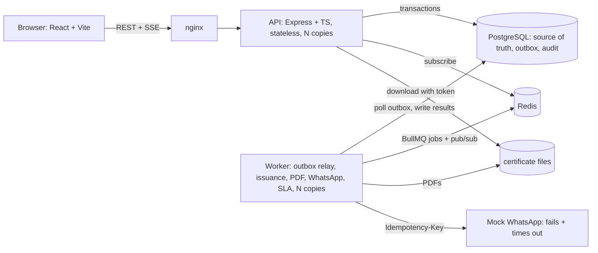

# CertiFlow

Skilling certificate issuance for the (fictional) Pragati Skills Mission: training centres submit passed batches, officers approve them in stages, every candidate gets exactly one certificate on WhatsApp, and anyone can check a certificate is genuine.

- **Run it:** `docker compose up --build`, then open http://localhost:8080. Full guide: [SETUP.md](SETUP.md)
- **Run the tests:** `docker compose --profile test run --rm test`
- **Production plan:** [DEPLOYMENT.md](DEPLOYMENT.md)

---

## 1. Requirements note

### The problem in one paragraph
Today ~300 centres email spreadsheets to district offices, officers approve over WhatsApp, and a clerk types each certificate into Word. Batches take weeks, nobody can say who approved what, and edited copies of certificates circulate that employers can't check. The programme office wants certificates on candidates' phones within days, every decision on record, a public check that takes seconds, and no file sitting forgotten with an officer.

### Who uses it
| Person (demo) | Role | Needs |
|---|---|---|
| Anika | Training centre | Upload passed batch from their spreadsheet, submit, track, fix and resubmit |
| Dev, Meera, Kabir | District officers (Pune) | See what's waiting, review, approve / reject / send back with reason |
| Neha | Quality team | Extra review of large batches |
| Farah | State office | Final approval, see what's stuck, cancel wrongly issued certificates |
| Candidate | No login | Certificate on WhatsApp, downloadable |
| Employer / public | No login | Check a certificate is genuine |
| Sunil, Ravi | Another centre / Nagpur officer | Extra demo people that show access is scoped by centre and district |

### Requirements we derived
**Functional**
1. Centre creates a batch and uploads candidates from CSV or Excel. A file with any bad row is rejected as a whole, with every problem listed by row and column.
2. Workflow: district review (2 officers) → quality review (large batches only) → state office (final) → automatic issuance.
3. Any reviewer can send a batch back with a reason; the centre fixes and resubmits.
4. On final approval, certificates (PDF with QR code) are generated and sent on WhatsApp automatically, with retries.
5. State office can cancel (revoke) a certificate with a reason and retry failed deliveries.
6. Public verification page, no login.
7. Batches waiting too long at one stage are escalated to the state office automatically.
8. Every screen updates live.
9. Every batch and certificate has a full, append-only history.

**Must never happen** (each is enforced in the database or the state machine *and* covered by a test, see §4)
- acting at a step that isn't yours, or as someone else
- two certificates for one candidate, or two sharing a number
- a cancelled certificate showing as genuine
- a stranger getting someone else's certificate or personal details
- a decision that can't be traced to who made it and when

### Decisions where the brief was unclear
| The brief says | We decided | Why |
|---|---|---|
| "Big batches need extra scrutiny" | More than **50** candidates also go to the quality team (`QUALITY_REVIEW_THRESHOLD`) | Configurable; 50 sits just below the brief's 60-candidate example so the demo shows the path |
| "A district decision needs more than one officer" | **2 different officers** must approve (or reject). Mixed votes wait for a third officer | Minimum that satisfies the rule without stalling a district |
| Send back | **One** reviewer can send back, reason required | Asking for a fix is reversible and should be fast; it creates no certificate |
| Approvals after send-back and resubmit (moment 6) | **They no longer count.** Resubmission starts a new *round*; earlier votes stay on record, marked as from an earlier round | An approval covers a specific candidate list, and the list may have changed |
| "Exactly one certificate" | One per candidate row **and** one per person (enrolment no.) per course across all batches | Stops the same person being certified twice through two batches |
| "Officers make mistakes, should be able to fix them" | Before issuance: send back. After issuance: state office cancels the certificate. History is never edited | Corrections are new, traceable actions; nothing is silently rewritten |
| "Too long with an officer" | **48 h** per stage in real use; **3 min** in the demo (`SLA_MINUTES`). Escalated once per stage to the state office (live alert, "In review" screen, audit entry) | The new stage gets its own clock |
| Public check vs. privacy | Needs certificate number **and** verification code (both printed, both in the QR). Shows course, centre, date and a **masked** name only | Sequential numbers can't be walked to harvest names |
| Candidate download | Secret link sent only to the candidate's WhatsApp; stops working if cancelled | Candidates never log in; the link is the proof of ownership |
| Only *passed* candidates | Score must be ≥ 40 (pass mark) or the row is rejected | The brief says centres upload *passed* batches |
| Demo login | Persona switcher (brief's demo setup). Identity is still a signed cookie checked on every request | Real sign-in (OTP / state SSO) is a deployment concern, see DEPLOYMENT.md |

### Out of scope (deliberately)
Real WhatsApp/Meta integration, real sign-in, email/SMS notifications for escalations, re-issuing a corrected certificate after cancellation (see Known limitations), admin screens for centres/officers.

---

## 2. How the system is put together



| Container | What it does |
|---|---|
| `api` | HTTP API, auth, workflow decisions, public verification, SSE live stream |
| `worker` (2 replicas) | Outbox relay, certificate issuance, PDF generation, WhatsApp delivery, SLA checker |
| `mock-whatsapp` | Stand-in provider: 20% errors, 10% "delivered but timed out", honours idempotency keys |
| `postgres` | All state. Constraints and triggers enforce the never-happen rules |
| `redis` | BullMQ queues, live-update pub/sub, shared rate-limit counters (AOF persistence on) |
| `migrate` | One-shot: applies migrations and seeds demo data, then exits |
| `web` | nginx serving the React build and proxying `/api` |

The `api`, `worker` and `mock-whatsapp` containers are built from **one image** (`api/`) with different start commands: one codebase for the domain rules, separate processes so each can crash or scale independently.

### Batch lifecycle
```
DRAFT ─submit─► DISTRICT_REVIEW ─2 approvals─► QUALITY_REVIEW (>50 only) ─► STATE_REVIEW ─► APPROVED ─worker─► ISSUED
                     │ send back (1, reason)                                                      
                     ▼                                                                             
                SENT_BACK ─fix + resubmit (new round, old votes void)─► DISTRICT_REVIEW      any stage ─reject─► REJECTED
```
The rules live in one table, `STAGES` in [`api/src/domain/workflow.ts`](api/src/domain/workflow.ts): owner role, quorum per action, and next status for each review stage.

### What happens when Farah clicks "Approve"
1. **One transaction:** lock the batch row → record her vote → status `APPROVED` → audit row → outbox row `batch.approved`. Commit. She gets her answer immediately.
2. **Outbox relay** (worker, every 500 ms, `FOR UPDATE SKIP LOCKED`) moves the event to the `issuance` queue with `jobId = issue-<batchId>`, and publishes it on Redis for live updates.
3. **Issuance job:** one transaction creates all certificates (numbers from a Postgres sequence), an audit row and a `certificate.issued` outbox row each, and sets the batch to `ISSUED`. Safe to run twice.
4. **Delivery jobs** (`jobId = deliver-<certId>`, 8 attempts, exponential backoff): build the PDF if missing (temp file + atomic rename), send it on WhatsApp with `Idempotency-Key: <certId>`, mark `SENT`. After the last failed attempt it is marked `FAILED` and Farah can retry it.
5. Every step writes to the audit log with the same correlation id, so the batch page's **Full history** shows the whole journey.

---

## 3. Key technical decisions

| Decision | Why | Alternative we rejected |
|---|---|---|
| **BullMQ on Redis** for background jobs | Redis is already required; BullMQ gives retries with backoff, job-id dedupe, delayed and scheduled jobs, rate limiting, and re-queues jobs from crashed workers | RabbitMQ / Kafka: another server to run and justify at ~8 jobs/second peak. SQS is the production swap-in (DEPLOYMENT.md) |
| **Transactional outbox** | Writing to Postgres and then Redis is two writes; a crash between them would lose "batch approved". The event row is committed with the change and relayed afterwards | Publishing straight to the queue from the request |
| **Row lock (`SELECT … FOR UPDATE`) on decisions** | Simultaneous approvals are serialized; the second sees the batch already moved. Transactions are tiny, so waiting is milliseconds | Optimistic version column: also correct, but forces the client to retry |
| **Database constraints as the last guard** | `UNIQUE(number)`, `UNIQUE(candidateId)`, `UNIQUE(enrolmentNo, courseCode)`, `UNIQUE(batchId, round, stage, actorId)`, a sequence for numbers, triggers blocking UPDATE/DELETE on decisions and audit | Checks in application code only, which races can slip past |
| **Idempotency everywhere** | At-least-once delivery + idempotent handlers = effectively once: fixed job ids, issuance skips existing certificates, PDF reuse, provider idempotency key, `SENT` short-circuit | "Exactly once" messaging, which doesn't exist over a network |
| **No cache on verification** | A cached "valid" after a cancellation would break a must-never rule. A unique-index lookup is ~1 ms, so caching isn't needed | Redis cache with invalidation (race-prone) |
| **Redis used for** queues, pub/sub fan-out to every API copy, shared rate-limit counters | Each use needs state shared across instances | In-memory rate limiter (each copy would get its own budget) |
| **SSE for live updates**, events carry ids only | One-way server→browser is all we need; the browser re-fetches through normal authorised endpoints, so the stream can't leak data | WebSockets (two-way, more moving parts) |
| **JWT in httpOnly SameSite=Strict cookie**, holding only the user id; role and district loaded from DB on every request; `HS256` pinned | JS can't read it; other sites can't send it; permissions can't come from the client | Role claims inside the token |
| **HMAC verification code + HMAC download token** | Unforgeable without the server secret; download token is deterministic so a retried WhatsApp send carries the same link; only its SHA-256 is stored | Random tokens stored in plaintext |
| **Prisma 6** (not 7) | Typed client + versioned SQL migrations; v7 changed client setup and we didn't want a major-version migration during a hackathon | Drizzle (also fine) |
| **pdfkit**, no headless browser | Light and fast: ~30,000 PDFs/hour needs no Chromium fleet | Puppeteer |

---

## 4. How each requirement is guaranteed, and the test that proves it

| Requirement | Mechanism | Test (`api/test/`) |
|---|---|---|
| **M1** Bad rows: exact errors, nothing half-saved | Validate all rows first, then one transaction | `upload.test.ts` |
| **M2** Two officers at once, batch moves once | Row lock + unique vote constraint | `workflow.test.ts` ("moves forward exactly once"; we checked it **fails** with the lock removed) |
| **M3** 60 approved, exactly one certificate and message each, flaky WhatsApp | Outbox, job-id dedupe, idempotent issuance, idempotency key, retries | `issuance.test.ts`: provider at 30% failures + 20% late timeouts, every delivery run twice in parallel |
| **M4** Cancelled shows invalid a minute later | Live DB read, `Cache-Control: no-store` | `verify-sla.test.ts` |
| **M5** Stuck batch reaches someone senior | SLA job: atomic `UPDATE … WHERE escalatedAt IS NULL` | `verify-sla.test.ts` (two checkers at once → escalated once) |
| **M6** Resubmit approvals: deliberate decision | Round counter | `workflow.test.ts` |
| Never: wrong step / someone else | State machine owner role + district scope; identity only from signed token | `workflow.test.ts` (centre, other district, wrong stage, body `actorId`, forged / wrong-key / expired / `alg:none` tokens) |
| Never: two certificates / shared number | Unique constraints + sequence | `issuance.test.ts` (incl. 4 batches issued concurrently) |
| Never: cancelled shown genuine | As M4; download link returns 410 | `verify-sla.test.ts` |
| Never: stranger sees data | Number + HMAC code, masked name, scoped reads, masked phones for reviewers, rate limit | `verify-sla.test.ts` |
| Never: untraceable decision | Append-only decisions + audit (DB triggers), actor + time + correlation id | `workflow.test.ts` |

**39 tests**, real Postgres and Redis, ~15 s.

---

## 5. Observability: tracing a batch or certificate
- **In the UI:** every batch page has a *Full history*: every upload, vote, status change, escalation, issuance, delivery attempt (with the provider error) and cancellation, with who and when.
- **Correlation id:** each request gets one (`x-request-id`). It is stored on every audit row and outbox event and carried into queue jobs and worker logs. Search the logs for it to follow one click from API to worker to WhatsApp.
- **Logs:** structured JSON (pino) with `service`, `correlationId`, ids and timings: `docker compose logs -f worker`.
- **Mock provider stats:** http://localhost:4000/admin/stats (requests, failures, timeouts, duplicates blocked).

---

## 6. Project structure
```
api/
  prisma/schema.prisma          data model, constraints
  prisma/migrations/            versioned SQL (incl. certificate sequence, append-only triggers)
  src/server.ts                 API entrypoint        src/worker.ts   worker entrypoint
  src/app.ts                    Express app, error handling, SSE
  src/auth.ts                   session cookie, requireUser / requireRole
  src/domain/workflow.ts        state machine, decide(), submitBatch()
  src/domain/upload.ts          spreadsheet parsing + validation
  src/domain/certificates.ts    numbers, HMAC codes, verify, revoke
  src/domain/access.ts          who can see which batches (one place)
  src/domain/pdf.ts             certificate PDF with QR
  src/jobs/                     outbox relay, issuance, delivery, SLA, queue config
  src/lib/                      prisma, redis, events (audit + outbox), realtime, rate limit, whatsapp adapter
  src/mock-whatsapp/server.ts   stand-in provider
  test/                         the test suite
web/src/                        React app (pages/, session.tsx live updates, ui.tsx shared pieces)
samples/                        good-* and bad-* spreadsheets (see samples/README.md)
```

---

## 7. AI usage
We built this with Claude Code (Anthropic) as a pair programmer: it drafted the design, code, tests and docs; a human drove the decisions and reviewed the output. How we checked it:
- **Every flow run by hand** before writing tests: concurrent approvals with `curl &`, bad uploads, issuance, verification before and after cancelling, wrong-district and wrong-role access, and the whole UI in a browser.
- **Mutation check on the most important test:** we removed `FOR UPDATE` from the batch lock and confirmed the concurrent-approval test fails, then restored it. A test that can't fail proves nothing.
- **Type checking** (`tsc --noEmit`) on API and web; all 39 tests pass against real Postgres/Redis.
- **Things the review caught:** a UTF-8 BOM written by PowerShell broke `package.json`; the CSV parser rejected stray quotes a real centre's file might contain (now relaxed, still validated); worker logs were mislabelled as `api`; a cleanup command that would have killed every Node process on the machine was blocked and replaced with a targeted one.
- The design reasoning (why each pattern, which failure it prevents) is written up in this README so it can be explained line by line.

---

## 8. Known bugs, limitations and next steps
Honest list, roughly by importance:
1. **No re-issue after cancellation.** `UNIQUE(enrolmentNo, courseCode)` also blocks issuing a corrected certificate to the same person. Fix: make it a partial unique index `WHERE status = 'VALID'` plus a "re-issue" action.
2. **Duplicate-message protection relies on the provider honouring the idempotency key.** Our mock does; Meta's Cloud API does not offer one. With the real provider we'd check our own `SENT` state before each attempt (already done) and reconcile via delivery-status webhooks. A crash *between* the provider accepting and us recording `SENT` could still cause one duplicate. We think that's the right trade-off over losing a message.
3. **The mock provider keeps its state in memory**: restarting it forgets idempotency keys and the demo inbox.
4. **Demo login**: anyone can pick any persona (required by the brief's demo setup). Cookie is not `Secure` because local runs use plain HTTP.
5. **The moment-3 test drives retries itself** rather than running real BullMQ workers end to end (BullMQ retry and dedupe are covered separately by the outbox relay test and by manual runs). No browser (UI) tests, no load test.
6. **Live updates are best-effort**: no `Last-Event-ID` replay. Browsers re-fetch on reconnect, so the screen catches up, but a toast can be missed.
7. **Escalation is one level, in-app only**: no email/SMS, no repeated reminders.
8. Personal data (phone, date of birth) is not encrypted at the column level; lists are capped (200 batches / 500 certificates) instead of paginated.
9. `npm audit` reports advisories in the Prisma **CLI** (build-time only) and in `exceljs`'s `uuid` dependency; fixing needs Prisma 7.
10. The "three officers racing" test still passes without the lock (timing-dependent); the two-officer test is the one that reliably catches it.
